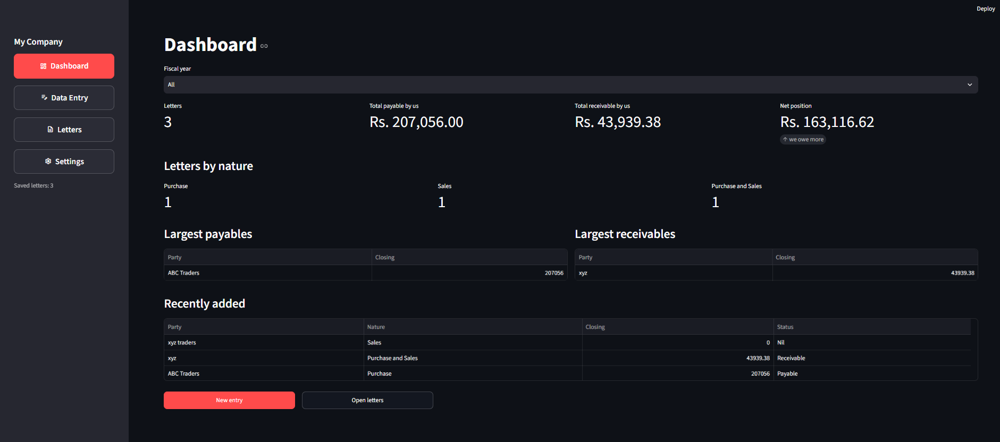
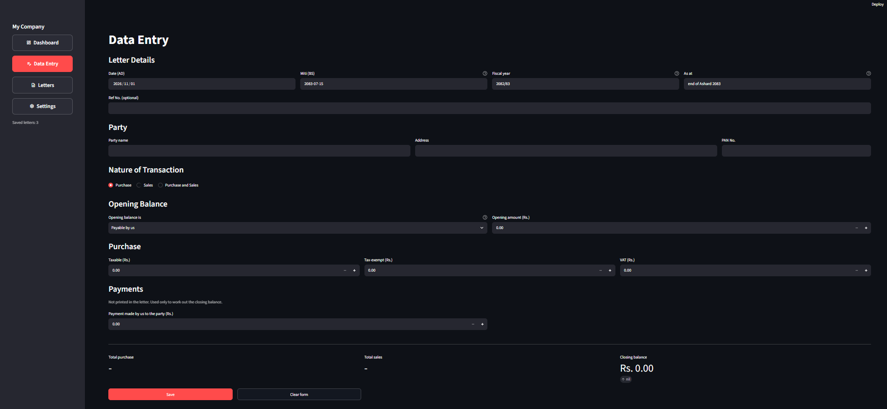
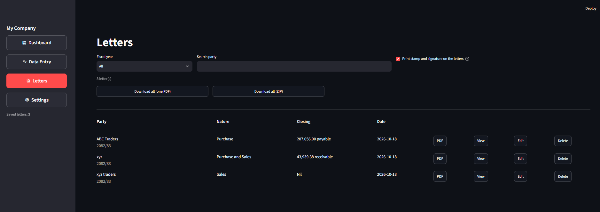
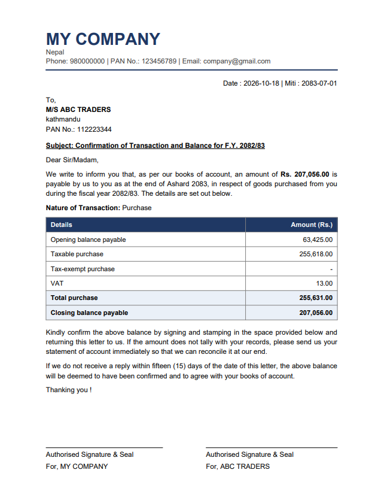

# Account Confirmation Letters

Preparing balance confirmation letters by hand for dozens of parties every year is slow and
error-prone. This app turns one form per party into a ready-to-sign PDF, with totals and the
closing balance calculated automatically.

Built with Python, [Streamlit](https://streamlit.io) and [ReportLab](https://www.reportlab.com).

> **Designed to run locally.** Each company runs its own copy on its own computer, so its data
> never leaves that machine. There is no server, no database and no login to maintain.

## Screenshots

| Dashboard | Data Entry |
| --- | --- |
|  |  |

| Letters | Generated letter (PDF) |
| --- | --- |
|  |  |

*All screenshots use sample data.*

## Features

- **Dashboard**: letter count, total payable and receivable, letters by nature, largest balances, recent entries.
- **Data Entry**: one form per party. Choosing *Purchase and Sales* reveals the sales fields as well.
- **Three letter layouts**, chosen automatically from the nature of the transaction:
  - *Purchase*: one amount column.
  - *Sales*: one amount column.
  - *Purchase and Sales*: Purchase and Sales side by side, with a single opening and closing balance.
- **Automatic calculation** of totals and the closing balance, shown live while typing.
- **Letters page**: preview, download a single PDF (named after the party), download everything as one PDF or a ZIP, edit or delete any letter.
- **Stamp and signature**: upload once; white backgrounds are removed, margins are trimmed, and size and overlap are adjustable. Can be switched off for hand-signed copies.
- **Fiscal year support**: change the default fiscal year each year; older letters stay available through a filter.
- **Date (AD) with automatic Miti (BS)** conversion.

## Tech stack

| Area | Tools |
| --- | --- |
| Language | Python |
| User interface | Streamlit |
| PDF generation | ReportLab |
| Data handling | pandas, openpyxl (Excel storage) |
| Image processing | Pillow (stamp and signature clean-up) |
| Date conversion | nepali-datetime |

## Design decisions

**Local-first, no server or database.** The letters contain financial data, so the app keeps
everything on the computer that runs it. Each company uses its own copy, which means there is no
shared storage, no data to leak between companies, and no hosting, login or database to maintain.
The trade-off is that backups are the user's responsibility (see *Data and privacy*).

**Plain Excel for storage.** Saved letters live in `data/parties.xlsx`. It is easy to inspect,
back up and open in Excel without any extra tools.

**One place for the arithmetic.** All balance logic lives in a single function (`calc` in
`letters.py`), so the form preview, the dashboard and the PDF always show the same numbers.

**Letter layout follows the data.** Purchase-only and sales-only parties get a simple single-column
table; parties with both get a side-by-side table with one closing balance, instead of two
conflicting balances.

## Requirements

- Python 3.10 or newer (check with `python --version`)
- [Visual Studio Code](https://code.visualstudio.com/) (recommended) or any terminal

## Running locally

1. Clone the repository and open the folder in VS Code (**File > Open Folder**).
   ```bash
   git clone https://github.com/Saameerr/confirmation-letter-generator.git
   cd confirmation-letter-generator
   ```
2. Open a terminal in VS Code (**Terminal > New Terminal**).
3. *(Recommended)* Create and activate a virtual environment. This keeps the project's packages
   separate from the rest of your computer. Activate it again whenever you open a new terminal.
   ```bash
   python -m venv .venv

   # Windows (Command Prompt):  .venv\Scripts\activate
   # Windows (PowerShell):      .venv\Scripts\Activate.ps1
   # macOS / Linux:             source .venv/bin/activate
   ```
   You can skip this step and go straight to the next one.
4. Install the dependencies (once):
   ```bash
   pip install -r requirements.txt
   ```
5. Start the app:
   ```bash
   streamlit run app.py
   ```
   It opens at <http://localhost:8501>. To stop it, press `Ctrl + C` in the terminal.

On Windows you can also double-click `start_app.bat` after step 4.

To update later, run `git pull` and `pip install -r requirements.txt`. Your data is not touched.

## First run

The app opens on the **Settings** page and stays there until the required company details are
saved: company name, address, phone, PAN number, default fiscal year and the default "as at"
text (for example `end of Ashad 2083`). Email is optional. No company information is stored in
the source code.

## How the closing balance is calculated

```
Closing = Opening + Total purchase - Total sales - Payment made by us + Payment received by us
```

Opening balances are entered as an amount plus a type (*Payable by us* or *Receivable by us*).
A positive closing balance is printed as *payable by us to you*, a negative one as
*receivable by us from you*. Payments are used only for this calculation and are not printed
in the letter.

## Project structure

```
app.py             Streamlit interface (pages, forms, storage)
letters.py         PDF generation and balance calculation
requirements.txt   Python dependencies
start_app.bat      Windows launcher
docs/screenshots/  README screenshots (sample data only)
data/              Created at runtime: parties.xlsx and settings.json   (not committed)
assets/            Created at runtime: stamp and signature images       (not committed)
```

## Data and privacy

All data stays on the computer running the app:

| File | Contents |
| --- | --- |
| `data/parties.xlsx` | Every saved letter. Can be opened in Excel (close it before saving in the app). |
| `data/settings.json` | Company details and defaults. |
| `assets/` | Stamp and signature images. |

`.gitignore` excludes `data/` and `assets/`, so business data is never pushed to Git.

- **Back up the `data` and `assets` folders regularly.** If the computer is lost, the data is lost with it.
- The app has no login. Use it on a trusted computer and **do not deploy it to a public host**
  (for example a public Streamlit Cloud app), because anyone who could open the page could
  read and change the data.

## Notes

- Write party names in English; Nepali (Devanagari) characters do not render in the PDF with the built-in font.